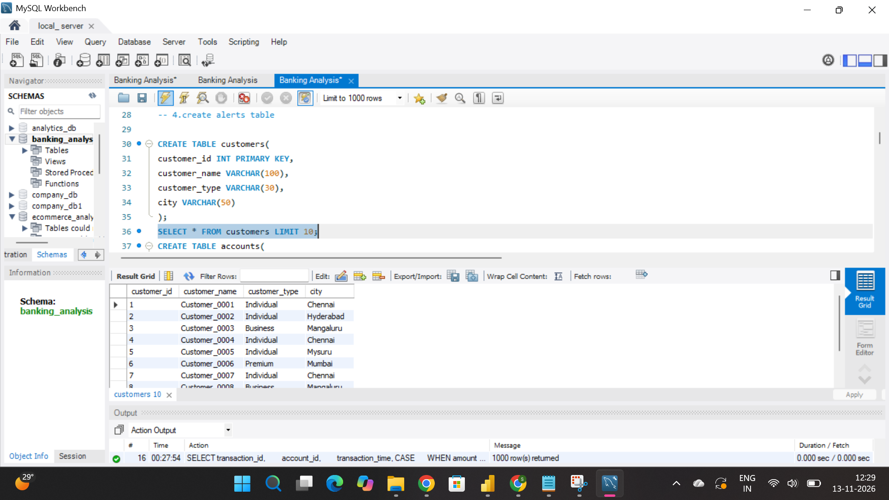
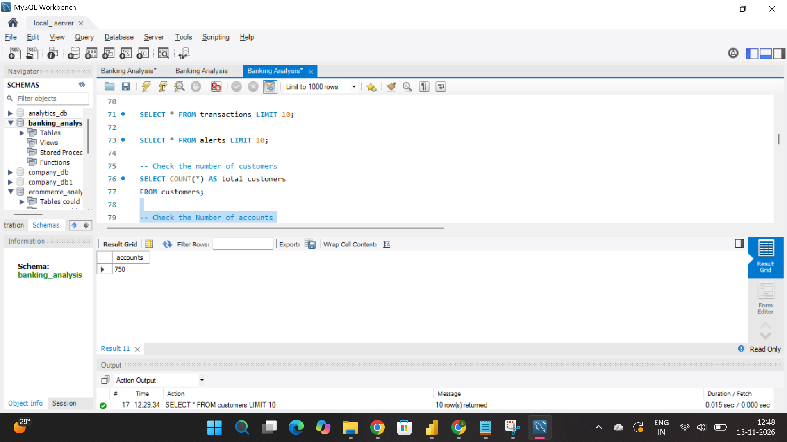
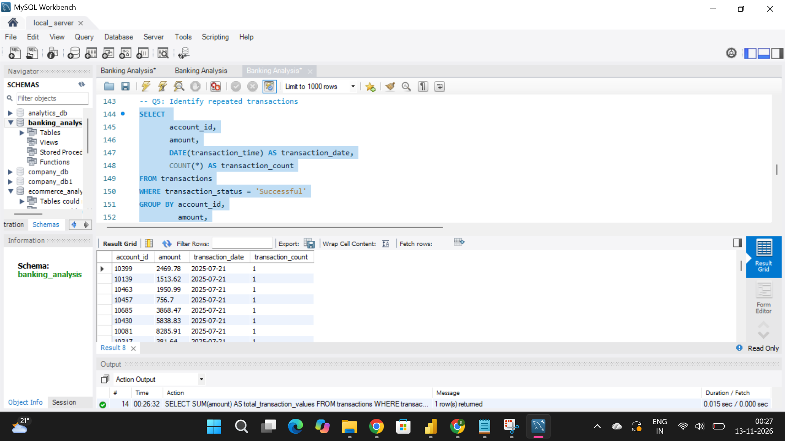
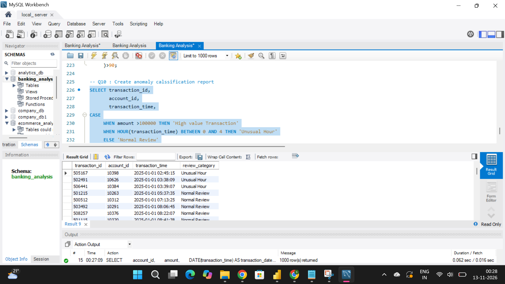

# SQL-banking-transaction-analysis
Banking Transaction Monitoring and Anomaly Analysis using MySQL

SQL Data Analytics Project | MySQL

1. Project Overview

This project focuses on analyzing banking transactions using MySQL to identify unusual transaction patterns and potential anomalies.

The objective is to help banking operations teams monitor transactions and identify accounts that require further investigation.

2. Business Objectives

- Analyze banking transaction patterns.
- Identify high-value transactions.
- Detect repeated transaction amounts.
- Identify frequent transactions.
- Analyze failed transactions.
- Detect unusual transaction activity.
- Identify inactive accounts that become active after 90 days.

3. Tools and Technologies
- MySQL 8.0
- MySQL Workbench
- SQL
- Common Table Expressions (CTEs)
- Window Functions
- Aggregate Functions
- Date and Time Functions

4. SQL Concepts Used

- SELECT, WHERE, GROUP BY, HAVING
- JOINS
- Subqueries
- CTEs
- LAG() and LEAD()
- DATEDIFF()
- COUNT(), SUM(), AVG()
- CASE statements

5. Business Analysis

The project covers transaction monitoring and anomaly investigation, including:

1. High-value transaction analysis
2. Repeated amount candidates
3. Frequent transaction analysis
4. Failed transaction analysis
5. Unusual transaction time analysis
6. Inactive account reactivation analysis

6. Key Learning Outcomes

- Practical SQL query writing.
- Banking transaction analysis.
- Identifying unusual transaction patterns.
- Applying window functions to real-world business problems.
- Translating business requirements into SQL queries.

7. Important Note

An unusual transaction is considered an anomaly candidate and does not automatically indicate fraud. Further investigation is required.

8. Author

Data analytics

## Project Screenshots

### 1. Database Tables

### 2. Data Validation

### 3. Transaction Analysis

### 4. Anomaly Detection

